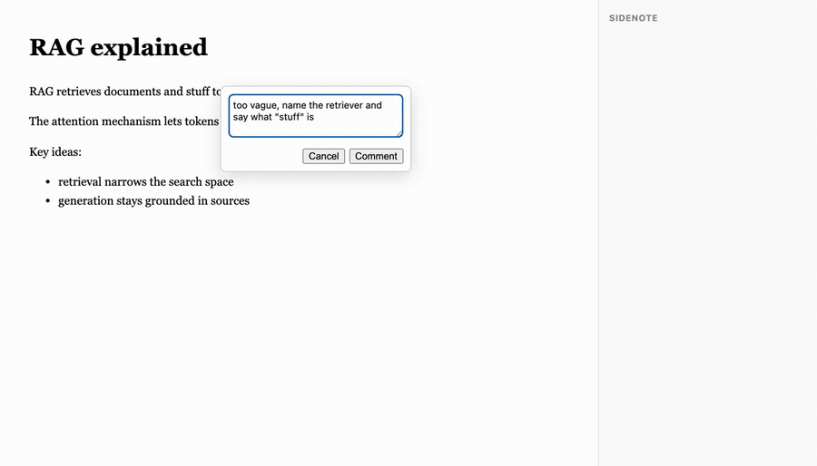
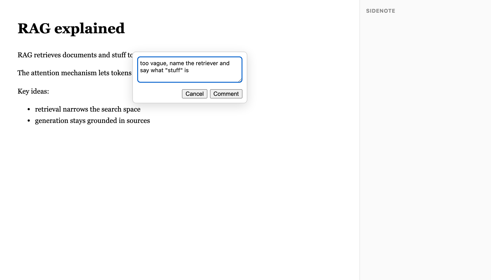
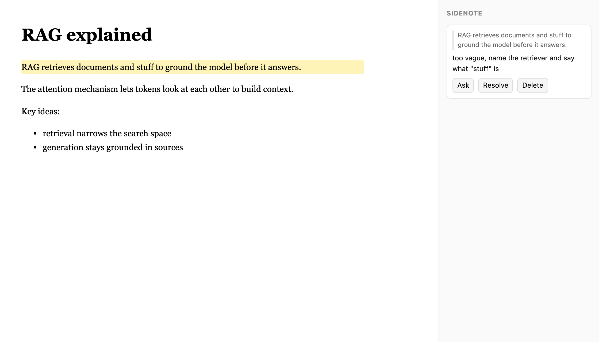
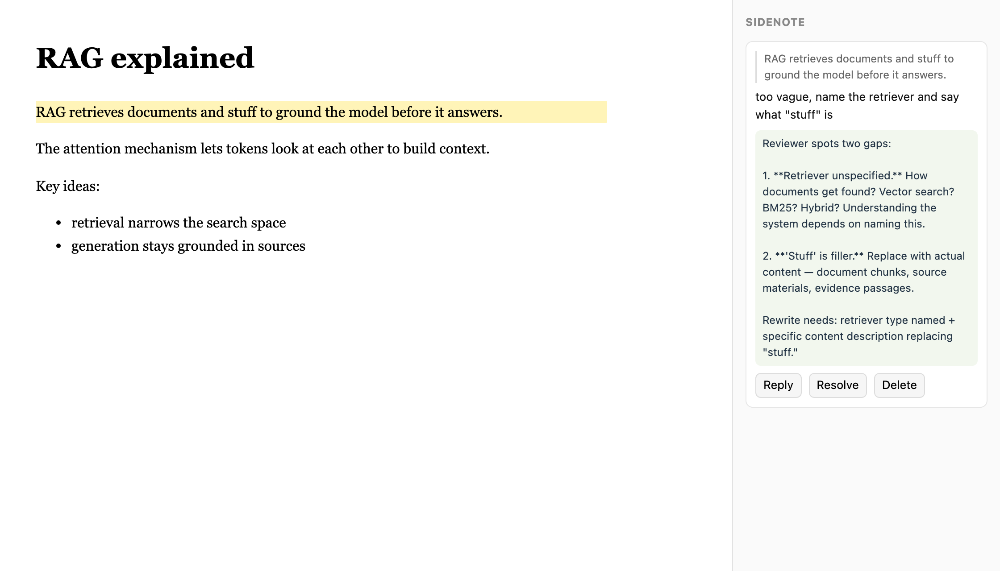
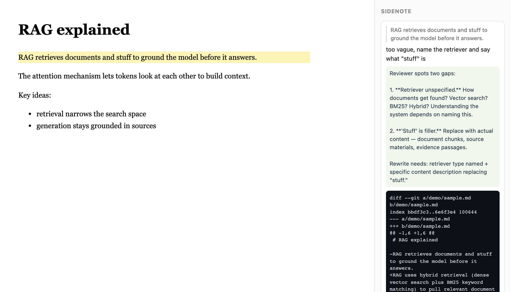

# sidenote

[](https://github.com/bharadwaj-pendyala/sidenote/actions/workflows/ci.yml)
[](https://www.npmjs.com/package/sidenote-cli)
[](https://www.npmjs.com/package/remark-sidenote)
[](./LICENSE)
[](https://sidenote-playground.vercel.app)

**Comment on your rendered markdown site like a Google Doc. An LLM resolves the comments into a clean git diff. You never leave the browser.**



**[Try it in your browser →](https://sidenote-playground.vercel.app)** No install: a real rendered post, the real overlay, and a scripted stand-in for the agent.

sidenote is a review layer for content authors. You review your own site on the local dev server, select a passage, and leave a comment, exactly like commenting in Google Docs or Word. A local coding agent (`claude` or `codex`) either answers your question in place or patches the source markdown and hands you back a git diff to accept or reject.

It is **not an editor**. You annotate intent; the agent makes the edit. Source markdown stays the source of truth.

## How it works

**1. Select a passage on your rendered page and write what you want changed.** Google-Docs muscle memory.



**2. The comment pins to the rail.** From here you can Ask about it or Resolve it into an edit.



**3. Ask, and the agent answers in the thread.** No file is touched; it is a conversation.



**4. Resolve, and the agent patches the source.** You review the real git diff inline, then Accept or Reject.



## Why

Authoring a blog means bouncing between the browser (to see the rendered page) and the terminal (to ask an agent for a fix). That context-switch is the tax. sidenote closes the loop inside the browser.

## What you can do

- **Select and comment** on any block of your rendered page (Google-Docs muscle memory).
- **Ask** a question about a passage and get an answer in the rail thread, with no edit to the file.
- **Resolve** a comment into a real edit, review the git diff inline, then Accept or Reject.
- **Reply** to keep discussing, then turn the thread into an edit when you are ready.
- Watch the agent work **live** (activity and streamed answer) instead of staring at a spinner.
- **Reject** reverses only that comment's patch; a **drift guard** refuses to patch a passage whose source changed since you commented.

## Works with

| Site | Setup |
|---|---|
| **Astro** (`.md` pages and content collections) | [guide](./docs/guides/astro.md) |
| **Docusaurus** (docs, blog, pages) | [guide](./docs/guides/docusaurus.md) |
| **Next.js** (`@next/mdx` or your own `remark()` call) | [guide](./docs/guides/nextjs.md) |
| Anything else that renders markdown through remark | [Quick start](#quick-start) |

`sidenote init` detects Astro, Docusaurus and Next.js and prints the exact steps for your setup.

## Requirements

- Node.js 18 or newer.
- `claude` or `codex` on your `PATH` for real edits (a zero-LLM `mock` agent is used for tests).
- A site that renders markdown through `remark` (see [Works with](#works-with)).

## Quick start

```bash
npm install --save-dev remark-sidenote   # the offset stamper for your markdown pipeline
npx sidenote-cli init --agent claude     # detects your framework, prints 2 wiring steps
npx sidenote-cli dev                     # run the daemon next to your site
```

The two steps are: add `remark-sidenote` to your remark plugins, and load
`http://localhost:4517/overlay.js` in dev only. The [guides](./docs/guides) show
both for each framework.

`init` writes `.sidenote/config.json`:

```json
{
  "agent": "claude",
  "contentDir": "content",
  "port": 4517,
  "askModel": "haiku",
  "resolveModel": "opus"
}
```

`contentDir` is where sidenote may edit markdown. It can be a list, and `init` lists every folder your framework keeps pages in (for Astro, `["src/content", "src/pages"]`). `askModel` / `resolveModel` are optional. Ask/Reply default to a fast model; Resolve keeps the agent's default. See [TESTING.md](./TESTING.md) to try the full loop, with or without an LLM.

## Layout

```
packages/
  remark-plugin/   stamps source offsets onto rendered HTML blocks
  daemon/          localhost comment store + resolve loop (claude | codex | mock)
  overlay/         injected browser overlay: select to comment, rail, live diff
bin/sidenote.js    init + dev CLI
```

## Tests

```bash
npm test          # remark plugin + daemon suites (no browser)
npm run test:e2e  # full browser flow (needs Playwright)
```

## Roadmap

Ideas we want to build next. Each one has an issue; comment there if it matters to you.

- **More frameworks:** VitePress and other markdown-it sites, Hugo and Jekyll (non-remark, text-anchored).
- **Review on preview deploys:** comment on a Vercel or Netlify preview, not only on `localhost`.
- **Turn a review into a pull request:** resolve all comments on a branch and open a PR.
- **Several reviewers:** share a comment store so a team can review docs together.
- **Resolve all:** one click to resolve every open comment on a page (the daemon already supports it).

## Contributing

Issues and PRs welcome. See [CONTRIBUTING.md](./CONTRIBUTING.md) and the [Code of Conduct](./CODE_OF_CONDUCT.md).

## License

[MIT](./LICENSE)
